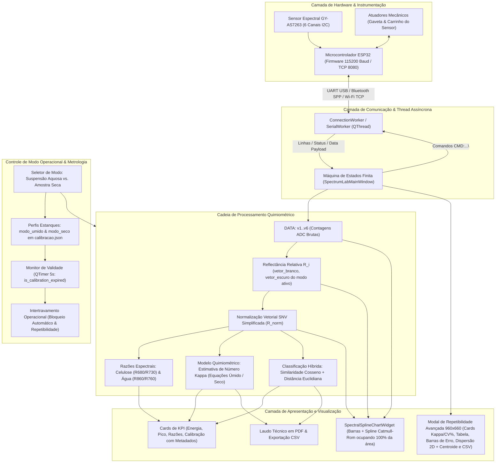
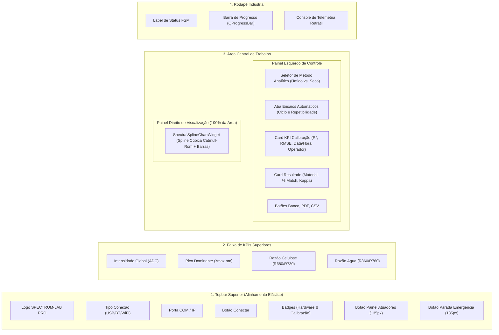
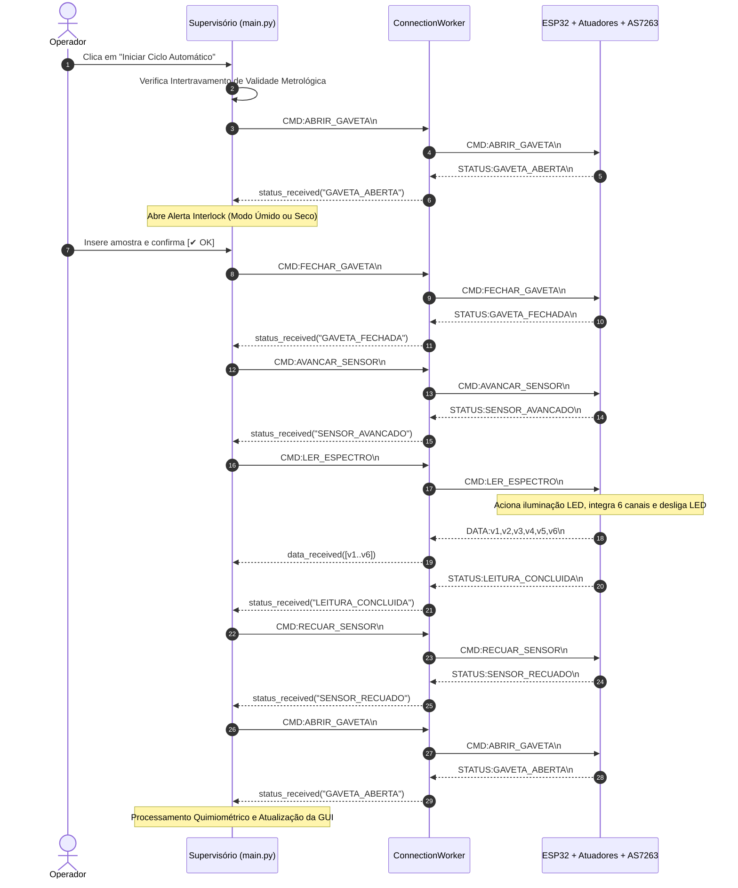
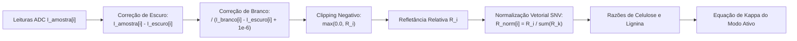

> Documento histórico da versão 4.9.14. Para o fluxo corrigido de calibração e aquisição da versão 4.10.0, consulte [README.md](README.md). Métricas fixas e procedimentos descritos abaixo não representam a versão atual.

# DOCUMENTAÇÃO TÉCNICA COMPLETA DO SISTEMA SUPERVISÓRIO INDUSTRIAL
**SPECTRUM-LAB PRO (v4.9.14 — Build 1250)**

- **Data da Documentação:** 04 de Setembro de 2026
- **Versão do Software:** v4.9.14 (Build 1250) — Release de Estabilidade: Tratamento e Exibição de Telemetria Pipe AS7263, High-DPI Automático e Kappa Sem Trava Superior
- **Objetivo do Sistema:** Sistema supervisório para controle de bancada, automação de atuadores eletromecânicos, aquisição óptica multicanal, calibração instrumental com controle de validade metrológica e processamento quimiométrico multivariado de dados espectrais na faixa VIS-NIR (610 a 860 nm).
- **Modos Operacionais:**
  1. **Modo 1: Suspensão Aquosa (Lâmina / Água Destilada):** Análise de polpa celulósica líquida sob lâmina/lamínula com compensação de solvente aquoso.
  2. **Modo 2: Amostra Seca (Reflectância Difusa):** Análise direta de folhas, mantas e polpa celulósica seca, calibrada contra padrão branco de cerâmica/Teflon.
- **Sensor Espectral Integrado:** AMS / Broadcom GY-AS7263 NIR Spectral Sensor (6 canais ópticos: 610, 680, 730, 760, 810, 860 nm).
- **Controlador Embarcado:** Espressif ESP32 (Arquitetura Dual Core, Barramento I2C, Controle de Servomotores de Gaveta e Sensor).
- **Tecnologias do Supervisório:** Python 3.x, PyQt5 (Qt GUI Framework), PySerial, Socket TCP/IP, SQLite3, Matplotlib, ReportLab PDF Engine.
- **Binário Executável Standalone:** Compilado via PyInstaller (`dist/SpectrumLabPro.exe`).

---



---

## 1. VISÃO GERAL DO SUPERVISÓRIO

### 1.1 Objetivo e Finalidade
O **SPECTRUM-LAB PRO** é um sistema supervisório industrial para controle, automação de bancada e espectroscopia multivariada de alta precisão. Suas finalidades principais compreendem:
1. **Controle de Atuadores Eletromecânicos:** Abertura e fechamento de gaveta de inserção de amostra e posicionamento automático do carrinho do sensor sobre a câmara de medição.
2. **Arquitetura Dual-Mode:** Suporte completo a dois métodos analíticos selecionáveis via interface:
   - **Suspensão Aquosa:** Análise de celulose dispersa em água com lâmina/lamínula, compensando o solvente óptico.
   - **Amostra Seca:** Análise direta de folhas e mantas celulósicas secas por reflectância difusa calibrada contra padrão de Teflon/cerâmica.
3. **Aquisição Multicanal VIS-NIR:** Leitura simultânea dos 6 canais do sensor GY-AS7263.
4. **Calibração Instrumental com Isolamento de Perfis:** Armazenamento independente de branco e escuro para cada modo, gravação atômica à prova de falhas (`os.fsync`) e metadados metrológicos (timestamp, operador, $R^2$, RMSE).
5. **Controle de Validade Metrológica com Intertravamento:** Monitoramento do tempo de expiração da calibração (1 min, 5 min, 1 h, 8 h ou 24 h) com bloqueio preventivo de ensaios quando expirada.
6. **Compensações e Normalização:** Cálculo de reflectância relativa ($R_i$) e normalização vetorial SNV (*Standard Normal Variate* simplificado).
7. **Modelos Quimiométricos Dedicados:** Equações empíricas específicas para suspensão aquosa e amostra seca com estimativa do Número Kappa e classificação do grau de alvura/deslignificação.
8. **Repetibilidade Estática Instrumental:** Ensaio com 5 aquisições ópticas consecutivas sem movimentação do sensor para eliminação de folgas mecânicas, com janela de resultados contendo gráfico de dispersão 2D, centroide, gráfico de barras com erro e exportação CSV.
9. **Emissão de Laudos:** Geração de laudos técnicos periciais em formato PDF e registros telemetrizados em CSV.

### 1.2 Arquitetura de Software
O software é modular e orientado a eventos assíncronos:
- **GUI Principal:** [`main.py`](file:///c:/Users/mateu/.gemini/antigravity-ide/scratch/spectrum_lab/main.py) em PyQt5 com Design System Windows 11 Fluent Dark.
- **Comunicação Assíncrona:** [`connection_worker.py`](file:///c:/Users/mateu/.gemini/antigravity-ide/scratch/spectrum_lab/connection_worker.py) executando em `QThread` própria com buffer sem bloqueio e tratamento anti-ruído.
- **Motor Quimiométrico:** [`chemometrics.py`](file:///c:/Users/mateu/.gemini/antigravity-ide/scratch/spectrum_lab/chemometrics.py) com lógica matemática e física estritamente desacoplada da GUI.
- **Banco de Dados e Acesso:** [`database.py`](file:///c:/Users/mateu/.gemini/antigravity-ide/scratch/spectrum_lab/database.py) gerenciando usuários com permissões granulares e autenticação SHA-256 em SQLite.
- **Geração de Laudos:** [`pdf_generator.py`](file:///c:/Users/mateu/.gemini/antigravity-ide/scratch/spectrum_lab/pdf_generator.py) utilizando ReportLab e Matplotlib com backend `Agg` blindado contra concorrência e memory leaks.

---

## 2. INTERFACE E DESIGN SYSTEM



### 2.1 Componentes Principais da Interface

#### A. Barra Superior (`_create_topbar`)
- **Seletor de Conexão (`combo_conn_mode`):** Comutação entre `"USB"`, `"BLUETOOTH"` e `"WIFI"`.
- **Porta COM (`combo_com`) e Configurações de Rede:** Compactados com largura fixa (`100px` e `110px`).
- **Alinhamento Elástico (`addStretch(1)`):** Garante espaçamento dinâmico entre os seletores de porta e os botões de ação da direita, impedindo esmagamento ou estouro horizontal.
- **Badges de Status (`badge_com` e `badge_calib`):** Instâncias de `ModernStatusBadge` exibindo o status operacional do hardware e o estado metrológico da calibração:
  - `"CALIBRADO"` (Verde `#10B981`)
  - `"EXPIRADA"` (Vermelho `#EF4444`)
  - `"NÃO CALIBRADO"` (Vermelho `#EF4444`)
- **Botão Painel Atuadores (`btn_modal_manual`):** Botão estilizado de 135px para manutenção mecânica autenticada.
- **Botão E-Stop Topbar (`btn_top_emergency`):** Botão de alta visibilidade de 185px (`#EF4444`) para corte imediato de movimento.

#### B. Seletor de Modo Operacional (`combo_op_mode`)
- Posicionado estrategicamente no topo do painel esquerdo de controle (`auto_layout`).
- Opções disponíveis:
  - `"umido"`: Suspensão Aquosa (Lâmina / Água)
  - `"seco"`: Amostra Seca (Reflectância Difusa)
- Ao ser alterado:
  1. Comuta o perfil ativo no motor quimiométrico (`self.chem_engine.set_mode(new_mode)`).
  2. Atualiza imediatamente o card KPI de calibração, timestamp e operador.
  3. Executa verificação de validade metrológica (`self._check_calibration_validity()`).
  4. Recalcula parâmetros espectrais da leitura em memória.

#### C. Painel de Gráficos Analíticos
- **`SpectralSplineChartWidget`:** Ocupa **100% da área do painel direito**, configurado com política de expansão total (`QSizePolicy.Expanding, QSizePolicy.Expanding`), eliminando cortes de visualização.
- Oferece três unidades de renderização:
  - `"Refletância (%)"`
  - `"SNV Norm (%)"`
  - `"Contagens (ADC)"`
- A interpolação contínua dos 6 comprimentos de onda utiliza Splines Cúbicas de Catmull-Rom convertidas para curvas Bézier cúbicas suaves.

#### D. Card de Diagnóstico & Telemetria do Sensor AS7263 (`CardDiagnosticoAS7263`)
- Posicionado na base inferior da interface ao lado do Card de Calibração.
- Monitora os parâmetros de engenharia do sensor óptico em tempo real via thread de eventos assíncrona:
  - **Temperatura Interna (`lbl_die_temp`):** Temperatura da junção de silício (Die Temp) em °C.
  - **Ganho PGA (`lbl_ganho`):** Fator de amplificação programável (1x, 3.7x, 16x, 64x).
  - **Tempo de Integração (`lbl_integracao`):** Período de integração do conversor ADC (ex: 140.0 ms).
  - **Driver de LED (`lbl_driver_led`):** Corrente aplicada ao emissor óptico (ex: `Ativo (50 mA)`).
  - **Hardware / Firmware (`lbl_hardware`):** Identificação física do silício (ex: `AS7263 NIR`).
  - **Status do Sensor (`lbl_status_sensor`):** Indicador de prontidão operacional (ex: `READY`, `Normal`).

---

## 3. SENSOR ESPECTRAL GY-AS7263

### 3.1 Especificações Físicas e Ópticas
- **Fabricante / Tecnologia:** AMS / Broadcom — Filtros de interferência óptica de silício integrados no chip.
- **Canais Ópticos:** 6 bandas na faixa VIS-NIR.
- **Resolução de Conversão:** 16-bit com ganho e tempo de integração configuráveis no ESP32.

| Canal | Comprimento de Onda ($\lambda$) | Letra AS7263 | Identificação no Supervisório | Cor Visual na GUI | Atribuição Espectroscópica |
| :---: | :---: | :---: | :---: | :---: | :--- |
| `0` | **610 nm** | **R** | 610 nm | `#EF4444` | Banda do Visível / Absorção de pigmentos |
| `1` | **680 nm** | **S** | 680 nm | `#DC2626` | Banda da Celulose e Clorofila residual |
| `2` | **730 nm** | **T** | 730 nm | `#C084FC` | Transição óptica e dispersão |
| `3` | **760 nm** | **U** | 760 nm | `#A855F7` | Banda de referência de Água ($H_2O$) |
| `4` | **810 nm** | **V** | 810 nm | `#9333EA` | Banda da Lignina residual / aromáticos |
| `5` | **860 nm** | **W** | 860 nm | `#7E22CE` | Absorção máxima de Água / espessura da gota |

### 3.2 Protocolo Serial de Telemetria e Diagnóstico (Delimitação por Pipe `|`)
O microcontrolador ESP32 transmite periodicamente linhas de telemetria diagnóstica com os parâmetros de runtime do chip AS7263:
```text
DIAG:37|GAIN:64x|INT:140.0ms|LED:50mA|HW:AS7263_NIR|STATUS:READY
```
*(ou sem o prefixo `DIAG:`, desde que contenha `GAIN:` e `INT:`).*

**Estrutura de Decodificação Desacoplada:**
1. **Limpeza e Delimitação:** A linha é higienizada removendo prefixos residuais (`DIAG:`) e segmentada pelo caractere delimitador pipe (`|`).
2. **Temperatura Real Isolada (`partes[0]`):** O primeiro índice é estritamente o valor térmico do chip. O supervisório remove sufixos/prefixos residuais (`TEMP:`, `°C`) e atualiza **exclusivamente** o label `lbl_die_temp` (ex: `37 °C`). É garantida a blindagem contra vazamento de campos adicionais para este widget.
3. **Mapeamento Chave:Valor (`partes[1:]`):** Os itens subsequentes são divididos em `chave:valor` pelo separador `:`:
   - `GAIN` $\rightarrow$ `lbl_ganho` (ex: `64x`)
   - `INT` $\rightarrow$ `lbl_integracao` (ex: `140.0ms`)
   - `LED` $\rightarrow$ `lbl_driver_led` (ex: `Ativo (50mA)`)
   - `HW` $\rightarrow$ `lbl_hardware` (ex: `AS7263 NIR`)
   - `STATUS` $\rightarrow$ `lbl_status_sensor` (ex: `READY`) e badge do card
4. **Thread-Safety:** A leitura é recebida pelo `ConnectionWorker` em `QThread` assíncrona e despachada via `pyqtSignal(str)` para o slot principal no thread gráfico, eliminando congelamentos e mantendo a taxa de atualização contínua.

---

## 4. CICLO DE AQUISIÇÃO E MÁQUINA DE ESTADOS (FSM)



---

## 5. CALIBRAÇÃO INSTRUMENTAL E CONTROLE METROLÓGICO

### 5.1 Isolamento Rígido de Perfis (`calibracao.json`)
O sistema mantém dois perfis estritamente isolados em `calibracao.json`:
- `"modo_umido"`: Contém o vetor de branco registrado com água destilada em lâmina e vetor de escuro.
- `"modo_seco"`: Contém o vetor de branco registrado com padrão difuso seco (Teflon / cerâmica) e vetor de escuro.

A estrutura do arquivo contém metadados completos de rastreabilidade:
```json
{
  "modo_ativo": "umido",
  "timeout_segundos": 86400,
  "modo_umido": {
    "is_calibrated": true,
    "timestamp": "2026-09-03 17:26:36",
    "operador": "Eng. de Qualidade e Processos",
    "notes": "Calibração Suspensão Aquosa (Lâmina + Água Destilada)",
    "vetor_branco": [1800.0, 1900.0, 2000.0, 2100.0, 2200.0, 2300.0],
    "vetor_escuro": [10.0, 15.0, 20.0, 25.0, 30.0, 35.0],
    "r2": 0.994,
    "rmse": 0.007,
    "n_amostras": 6,
    "canais_nm": [610, 680, 730, 760, 810, 860]
  },
  "modo_seco": {
    "is_calibrated": true,
    "timestamp": "2026-09-03 17:26:36",
    "operador": "Eng. de Qualidade e Processos",
    "notes": "Calibração Amostra Seca (Padrão Branco Teflon)",
    "vetor_branco": [2450.0, 2550.0, 2650.0, 2750.0, 2850.0, 2950.0],
    "vetor_escuro": [10.0, 15.0, 20.0, 25.0, 30.0, 35.0],
    "r2": 0.998,
    "rmse": 0.003,
    "n_amostras": 6,
    "canais_nm": [610, 680, 730, 760, 810, 860]
  }
}
```

### 5.2 Persistência Atômica com `os.fsync`
Para prevenir corrupção do arquivo de calibração em casos de queda abrupta de energia ou desligamento da bancada, o salvamento em `_save_full_json()` emprega escrita atômica:
1. Criação de arquivo temporário `.tmp` no mesmo diretório (`tempfile.mkstemp`).
2. Gravação dos dados via `json.dump`.
3. Forçamento de descarga de buffer do sistema operacional via `f.flush()` e `os.fsync(f.fileno())`.
4. Substituição atômica via `os.replace(temp_path, self.calib_file_path)`.

### 5.3 Controle de Validade Metrológica e Intertravamento Operacional
- **Intervalos de Validade (`CALIB_TIMEOUT_OPTIONS`):**
  - `60 s` (1 minuto — Teste Rápido)
  - `300 s` (5 minutos — Bancada)
  - `3600 s` (1 hora)
  - `28800 s` (8 horas — Turno Industrial)
  - `86400 s` (24 horas — Padrão Metrológico)
- **Monitoramento Contínuo por `QTimer`:**
  A cada 5 segundos, o método `_check_calibration_validity()` verifica se o tempo decorrido desde a calibração do modo ativo ultrapassa o timeout:
  $$\Delta t = t_{\text{atual}} - t_{\text{calibração}} > \text{timeout\_segundos}$$
- **Ações ao Vencer a Validade:**
  1. O badge de calibração muda para `"EXPIRADA"` com texto e indicador em vermelho fluorescente (`#EF4444`).
  2. Uma janela modal `CalibrationExpiredDialog` alerta o operador:
     > *"A calibração do método analítico ativo expirou! Por requisitos de conformidade e integridade espectral, é mandatório calibrar o instrumento antes de novos ensaios."*
  3. O botão direto `[ 🎯 Calibrar Agora ]` conduz o operador imediatamente ao assistente de calibração.
  4. **Intertravamento:** Os botões `"▶ Iniciar Ciclo Automático"` e `"🔁 Ensaio Repetibilidade"` são desabilitados via `setEnabled(False)` com tooltip explicativo, impedindo ensaios com parâmetros vencidos.

---

## 6. CADEIA DE PROCESSAMENTO E MODELOS QUIMIOMÉTRICOS



### 6.1 Refletância Relativa ($R_i$)
Calculada para cada canal óptico $i \in [0..5]$ a partir dos vetores de calibração do modo operacional ativo:

$$\boxed{R_i = \max\left(0.0, \; \frac{I_{\text{amostra}}[i] - I_{\text{escuro}}[i]}{(I_{\text{branco}}[i] - I_{\text{escuro}}[i]) + 10^{-6}}\right)}$$

### 6.2 Normalização Vetorial SNV Simplificada ($R_{\text{norm}}$)
Elimina variações de volume e espessura da camada de amostra dividindo pela soma total dos 6 canais:

$$\boxed{R_{\text{norm}}[i] = \frac{R_i}{\sum_{k=0}^5 R_k}}, \quad \text{assegurando que } \sum_{i=0}^5 R_{\text{norm}}[i] = 1.0$$

### 6.3 Razões Analíticas
- **Razão de Celulose (Eixo X):**
  $$\text{Cellulose Ratio} = \frac{R_{\text{norm}}[680\,\text{nm}]}{R_{\text{norm}}[730\,\text{nm}]} = \frac{R_{\text{norm}}[1]}{R_{\text{norm}}[2]}$$
- **Razão de Matriz Água (Eixo Y):**
  $$\text{Water Ratio} = \frac{R_{\text{norm}}[860\,\text{nm}]}{R_{\text{norm}}[760\,\text{nm}]} = \frac{R_{\text{norm}}[5]}{R_{\text{norm}}[3]}$$
- **Razão de Lignina:**
  $$\text{Lignin Ratio} = \frac{R_{\text{norm}}[860\,\text{nm}]}{R_{\text{norm}}[680\,\text{nm}]} = \frac{R_{\text{norm}}[5]}{R_{\text{norm}}[1]}$$

---

## 7. MODELOS ESPECÍFICOS DO NÚMERO KAPPA

A função `calculate_kappa_number` em `chemometrics.py` implementa equações distintas de acordo com o método analítico:

### 7.1 Modo 1: Suspensão Aquosa (Lâmina / Água Destilada)
Utiliza modelo empírico compensado pela matriz solvente aquosa:

$$\boxed{\text{Kappa}_{\text{calc}} = (\text{Lignin Ratio} \times 14.5) - (\text{Cellulose Ratio} \times 3.2) + 8.0}$$

$$\text{Kappa}_{\text{estimado}} = \max(2.0, \; \min(50.0, \; \text{Kappa}_{\text{calc}}))$$

#### Tabela de Classificação Industrial (Modo Úmido):
| Faixa de Kappa | Classificação da Polpa | Cor do Indicador |
| :---: | :---: | :---: |
| $\text{Kappa} < 15.0$ | **Polpa Branqueada** | `#10B981` (Verde) |
| $15.0 \le \text{Kappa} < 25.0$ | **Polpa Semi-Branqueada (Grau Médio)** | `#F59E0B` (Âmbar) |
| $\text{Kappa} \ge 25.0$ | **Polpa Não Branqueada (Alto Teor Lignina)** | `#EF4444` (Vermelho) |

---

### 7.2 Modo 2: Amostra Seca (Reflectância Difusa)
Calibrado contra o padrão branco difuso de Teflon/cerâmica sem lâmina de vidro e sem água. Utiliza um modelo linear parametrizado que desacopla a absorção no visível (escurecimento por lignina e cromóforos não alvejados em 610 nm) da inclinação espectral celulósica ($R_{680}/R_{730}$):

1. **Termo de Escurecimento no Visível ($610\,\text{nm}$):**
   $$\text{Fator}_{\text{escurecimento}} = \max\left(0.0, \; \frac{80.0 - R_{610,\%}}{100.0}\right) \times 45.0$$
   *(Só penaliza se $R_{610,\%} < 80\%$. Para celulose alva com $R_{610} \ge 80\%$, o termo é zero. Para papelão marrom com $R_{610} \approx 25\%$, adiciona $+24.75$ unidades de Kappa).*

2. **Termo de Inclinação Espectral de Lignina Residual ($R_{680}/R_{730}$):**
   $$\Delta_{\text{lignina}} = \max\left(0.0, \; (r_{\text{cel}} - 1.20)\right) \times 25.0, \quad \text{onde } r_{\text{cel}} = \frac{R[680\,\text{nm}]}{R[730\,\text{nm}] + 10^{-6}}$$
   *(Só penaliza se $r_{\text{cel}} > 1.20$. Para amostra de mercado de alta alvura com $r_{\text{cel}} \approx 0.91 - 1.15$, o termo é zero).*

3. **Composição e Saturação:**
   $$\text{Kappa}_{\text{calc}} = 0.5 + \text{Fator}_{\text{escurecimento}} + \Delta_{\text{lignina}}$$
   $$\boxed{\text{Kappa}_{\text{estimado}} = \text{round}\left(\text{clip}\left(\text{Kappa}_{\text{calc}}, \; 0.5, \; 50.0\right), \; 2\right)}$$

- **Celulose Branqueada de Mercado ($R_{610} = 100\%, r_{\text{cel}} = 0.91$):** $\text{Kappa} = \mathbf{0.50}$ (Alta Alvura).
- **Papelão Marrom / Massa Crua ($R_{610} \approx 25\%, r_{\text{cel}} \approx 2.08$):** $\text{Kappa} = \mathbf{47.25}$ (Alto Teor de Lignina).

#### Tabela de Classificação Industrial Neutra (Modo Seco):
| Faixa de Kappa | Classificação da Polpa | Cor do Indicador | Significado na Produção |
| :---: | :---: | :---: | :--- |
| **$\text{Kappa} < 1.5$** | **Polpa Branqueada Comercial (Alta Alvura)** | `#10B981` (Verde Esmeralda) | Celulose padrão de exportação, alvura superior a 90% ISO |
| **$1.5 \le \text{Kappa} < 12.0$** | **Polpa Branqueada (Grau Padrão)** | `#34D399` (Verde Claro) | Polpa branqueada padrão de mercado |
| **$12.0 \le \text{Kappa} < 25.0$** | **Polpa Semi-Branqueada (Grau Médio)** | `#38BDF8` (Azul Céu) | Estágio intermediário de deslignificação |
| **$25.0 \le \text{Kappa} < 35.0$** | **Polpa Kraft Não Branqueada / Marrom** | `#F59E0B` (Âmbar) | Polpa crua para caixas e sacos industriais |
| **$\text{Kappa} \ge 35.0$** | **Massa Celulósica Crua (Alto Teor de Lignina)** | `#EF4444` (Vermelho) | Alto teor de lignina residual / polpa marrom não alvejada |

---

## 8. REPETIBILIDADE ESTÁTICA INSTRUMENTAL

### 8.1 Eliminação de Folgas Mecânicas
Diferente de versões preliminares em que o carrinho avançava e recuava a cada medição, a FSM de repetibilidade estática (`_handle_repeatability_fsm`) executa o procedimento metrológico ideal:
1. **Avanço Mecânico Único:** Envio de `CMD:AVANCAR_SENSOR` uma única vez após fechamento da gaveta.
2. **Loop Estático com Pausa Térmica:**
   - Com o sensor imóvel sobre a amostra, dispara-se `CMD:LER_ESPECTRO`.
   - Ao receber `STATUS:LEITURA_CONCLUIDA`, armazena os 6 canais brutos e agenda a próxima leitura com `QTimer.singleShot(300, ...)` (300 ms de relaxação térmica para estabilização da junção do LED).
   - O ciclo se repete até completar as **5 varreduras estáticas** ($N = 5$).
3. **Recuo e Ejeção:** Somente após a 5ª leitura o sensor é recuado (`CMD:RECUAR_SENSOR`) e a gaveta é aberta (`CMD:ABRIR_GAVETA`), abrindo a janela de relatório.

### 8.2 Janela Modal de Repetibilidade Avançada (~960x660 px)
Implementada em `_display_repeatability_report()`, a janela oferece:
- **Cards KPI de Topo:**
  - **CV% Médio Global:** Indicador com código de cores ($<3\%$ verde, $3-6\%$ âmbar, $>6\%$ vermelho).
  - **Número Kappa Médio:** Exibe $\mu_K \pm s_K$ calculado a partir das 5 leituras individuais, com badge de classificação da polpa celulósica.
  - **Identificação da Amostra & Contagem:** Nome da amostra e $N = 5$.
- **Tabela Estatística Multicanal:** Médias ($\mu$), Desvios Padrão ($s$) e $CV\%$ dos 6 comprimentos de onda NIR.
- **Painel Gráfico Duplo do Matplotlib:**
  1. *Gráfico de Barras com Desvio Padrão ($yerr=s$):* Barras coloridas por canal com hastes de erro evidenciando a precisão óptica.
  2. *Gráfico de Dispersão 2D com Centroide:* Dispersão dos 5 disparos no plano Celulose ($R_{680}/R_{730}$) vs. Água ($R_{860}/R_{760}$) com o centroide $(\bar{X}, \bar{Y})$ marcado por estrela destacada em amarelo dourado (`#FBBF24`).
- **Exportação CSV:** Botão `"📥 Exportar Matriz 5x6 e Estatísticas (CSV)"` que gera arquivo delimitado por ponto e vírgula contendo metadados, as leituras brutas de cada um dos 5 disparos e a tabela estatística final.

---

## 9. MAPA COMPLETO DE IMPLEMENTAÇÃO

| Componente | Arquivo de Origem | Função / Método | Descrição da Responsabilidade |
| :--- | :--- | :--- | :--- |
| **Comunicação Multithread** | [`connection_worker.py`](file:///c:/Users/mateu/.gemini/antigravity-ide/scratch/spectrum_lab/connection_worker.py) | `ConnectionWorker.run` | Gerenciamento de portas USB, sockets TCP, parsing UTF-8 e despacho FIFO |
| **Máquina de Estados (FSM)** | [`main.py`](file:///c:/Users/mateu/.gemini/antigravity-ide/scratch/spectrum_lab/main.py) | `_on_serial_status_received` | Orquestração sequencial dos ciclos de ensaio, repetibilidade e calibração |
| **Seletor de Modo Operacional**| [`main.py`](file:///c:/Users/mateu/.gemini/antigravity-ide/scratch/spectrum_lab/main.py) | `on_operational_mode_changed` | Comutação de método (úmido vs seco), atualização de KPIs e validação |
| **Isolamento de Calibração** | [`chemometrics.py`](file:///c:/Users/mateu/.gemini/antigravity-ide/scratch/spectrum_lab/chemometrics.py) | `ChemometricsEngine.save_calibration` | Persistência atômica (`os.fsync`) de perfis independentes em `calibracao.json` |
| **Validade Metrológica** | [`chemometrics.py`](file:///c:/Users/mateu/.gemini/antigravity-ide/scratch/spectrum_lab/chemometrics.py) | `is_calibration_expired` | Cálculo temporal $t_{\text{atual}} - t_{\text{calib}} > \text{timeout}$ com opções de 1 min a 24 h |
| **Intertravamento de Segurança**| [`main.py`](file:///c:/Users/mateu/.gemini/antigravity-ide/scratch/spectrum_lab/main.py) | `_check_calibration_validity` | Desabilitação de botões de ensaio quando calibração expirada / ausente |
| **Reflectância e SNV** | [`chemometrics.py`](file:///c:/Users/mateu/.gemini/antigravity-ide/scratch/spectrum_lab/chemometrics.py) | `calculate_relative_reflectance` / `normalize_snv` | Correção por escuro/branco do perfil ativo e normalização por área unitária |
| **Modelos de Número Kappa** | [`chemometrics.py`](file:///c:/Users/mateu/.gemini/antigravity-ide/scratch/spectrum_lab/chemometrics.py) | `calculate_kappa_number` | Equação multivariada específica para polpa em suspensão aquosa ou folha seca |
| **Repetibilidade Estática** | [`main.py`](file:///c:/Users/mateu/.gemini/antigravity-ide/scratch/spectrum_lab/main.py) | `_handle_repeatability_fsm` | 5 aquisições com sensor imóvel, delay térmico de 300 ms e recuo final único |
| **Relatório de Repetibilidade**| [`main.py`](file:///c:/Users/mateu/.gemini/antigravity-ide/scratch/spectrum_lab/main.py) | `_display_repeatability_report` | Modal 960x660 px com Kappa médio $\pm s_K$, gráficos de erro e dispersão 2D |
| **Gráficos Espectrais** | [`animated_chart.py`](file:///c:/Users/mateu/.gemini/antigravity-ide/scratch/spectrum_lab/animated_chart.py) | `SpectralSplineChartWidget` | Renderização contínua com barras animadas e spline cúbica Catmull-Rom |
| **Geração de Laudos PDF** | [`pdf_generator.py`](file:///c:/Users/mateu/.gemini/antigravity-ide/scratch/spectrum_lab/pdf_generator.py) | `generate_pdf_report` | Diagramação ReportLab com barras dinâmicas (`FigureCanvasAgg` puro), isolamento headless e foco quantitativo |
| **Histórico no SQLite** | [`database.py`](file:///c:/Users/mateu/.gemini/antigravity-ide/scratch/spectrum_lab/database.py) | `DatabaseManager` | Tabela `leituras_historico` com 26 colunas registrando telemetria, ADC e reflectância |
| **Gerenciador de Histórico**| [`main.py`](file:///c:/Users/mateu/.gemini/antigravity-ide/scratch/spectrum_lab/main.py) | `HistoryDialog` | Diálogo Fluent 1080x720 px com busca, preview de KPIs, emissão direta de laudos, identificação exata de modo (seco/úmido) e exportação CSV |
| **Blindagem de Processo e Log**| [`main.py`](file:///c:/Users/mateu/.gemini/antigravity-ide/scratch/spectrum_lab/main.py) | `global_exception_handler` | Tratador `sys.excepthook` para captura de exceções não tratadas, geração de `crash.log` e prevenção de crash silencioso |
| **Splash Screen Dinâmica** | [`splash_screen.py`](file:///c:/Users/mateu/.gemini/antigravity-ide/scratch/spectrum_lab/splash_screen.py) | `AnimatedSplashScreen` | Tela de inicialização com vinculação dinâmica ao módulo `version.py` |
| **Controle de Acesso** | [`database.py`](file:///c:/Users/mateu/.gemini/antigravity-ide/scratch/spectrum_lab/database.py) | `DatabaseManager` | Autenticação SQLite com hash SHA-256 para liberação de modo manual |

---

## 10. COMPÊNDIO DE FÓRMULAS MATEMÁTICAS DO SISTEMA

### 1. Refletância Relativa Instrumental:
$$R_i = \max\left(0.0, \; \frac{I_{\text{amostra}}[i] - I_{\text{escuro}}[i]}{(I_{\text{branco}}[i] - I_{\text{escuro}}[i]) + 10^{-6}}\right), \quad i \in [0..5]$$

### 2. Normalização Vetorial SNV:
$$R_{\text{norm}}[i] = \frac{R_i}{\sum_{k=0}^5 R_k}, \quad \text{onde } \sum_{i=0}^5 R_{\text{norm}}[i] = 1.0$$

### 3. Modelo Quimiométrico do Número Kappa (Sem Trava de Teto):
- **Modo Suspensão Aquosa:**
  $$\text{Kappa} = \max\left(0.0, \; \left(\frac{R_{\text{norm}}[5]}{R_{\text{norm}}[1]} \times 14.5\right) - \left(\frac{R_{\text{norm}}[1]}{R_{\text{norm}}[2]} \times 3.2\right) + 8.0\right)$$
- **Modo Amostra Seca (Reflectância Difusa):**
  $$r_{\text{cel}} = \frac{R[680\,\text{nm}]}{R[730\,\text{nm}] + 10^{-6}}, \quad \text{Fator}_{\text{escurecimento}} = \max\left(0.0, \; \frac{80.0 - R_{610,\%}}{100.0}\right) \times 45.0$$
  $$\Delta_{\text{lignina}} = \max\left(0.0, \; (r_{\text{cel}} - 1.20)\right) \times 25.0$$
  $$\text{Kappa} = \max\left(0.0, \; \text{round}\left(0.5 + \text{Fator}_{\text{escurecimento}} + \Delta_{\text{lignina}}, \; 2\right)\right)$$

**Classificação Técnica Industrial por Faixas Reais de Kappa:**
- $\text{Kappa} \le 2.0$: **Polpa Branqueada de Mercado**
- $2.0 < \text{Kappa} \le 6.0$: **Polpa em Branqueamento (Intermediária)**
- $6.0 < \text{Kappa} \le 12.0$: **Polpa Deslignificada (Pós-O₂)**
- $12.0 < \text{Kappa} \le 22.0$: **Celulose Kraft Não Branqueada**
- $22.0 < \text{Kappa} \le 55.0$: **Polpa de Alto Rendimento / Embalagem**
- $\text{Kappa} > 55.0$: **Papelão / Fibras Recicladas**

### 4. Estatística da Repetibilidade (5 Varreduras Estáticas):
- Média por canal: $\mu_i = \frac{1}{5} \sum_{j=1}^5 x_{i,j}$
- Desvio Padrão por canal: $s_i = \sqrt{\frac{1}{4} \sum_{j=1}^5 (x_{i,j} - \mu_i)^2}$
- Coeficiente de Variação por canal: $CV_i\% = \left(\frac{s_i}{\mu_i}\right) \times 100\%$
- CV% Global Médio: $CV_{\text{global}}\% = \frac{1}{6} \sum_{i=0}^5 CV_i\%$
- Média do Número Kappa: $\mu_K = \frac{1}{5} \sum_{j=1}^5 \text{Kappa}_j$
- Desvio Padrão do Número Kappa: $s_K = \sqrt{\frac{1}{4} \sum_{j=1}^5 (\text{Kappa}_j - \mu_K)^2}$

### 5. Coordenadas do Centroide no Plano de Dispersão 2D:
$$\bar{X}_{\text{centroide}} = \frac{1}{5} \sum_{j=1}^5 \left(\frac{R_{\text{norm}}[680\,\text{nm}]}{R_{\text{norm}}[730\,\text{nm}]}\right)_j, \quad \bar{Y}_{\text{centroide}} = \frac{1}{5} \sum_{j=1}^5 \left(\frac{R_{\text{norm}}[860\,\text{nm}]}{R_{\text{norm}}[760\,\text{nm}]}\right)_j$$

### 6. Condição de Intertravamento Metrológico:
$$\text{Status Intertravamento} = 
\begin{cases} 
\text{LIBERADO}, & \text{se } \text{is\_calibrated} = \text{True} \;\land\; (t_{\text{atual}} - t_{\text{calib}}) \le t_{\text{timeout}} \\
\text{BLOQUEADO}, & \text{se } \text{is\_calibrated} = \text{False} \;\lor\; (t_{\text{atual}} - t_{\text{calib}}) > t_{\text{timeout}}
\end{cases}$$

---

## 11. HISTÓRICO DE RELEASES E MAPA DE VERSIONAMENTO SEMÂNTICO (v1.0 a v4.9.14)

O sistema de numeração segue rigorosamente a especificação de **Versionamento Semântico (SemVer 2.0.0)** combinado com numeração de build sequencial: **`v[Major].[Minor].[Patch] (Build [BuildNumber])`**.

| Versão Semântica | Data | Categoria | Evoluções Estruturais e Metrológicas Implementadas |
| :--- | :---: | :---: | :--- |
| **v1.0.0** | Inicial | Arquitetura | Protótipo serial síncrono inicial; interface gráfica com leitura direta de contagens brutas do sensor GY-AS7263. |
| **v2.0.0** | Evolução | Comunicação | Separação da comunicação serial em `QThread` assíncrona (`ConnectionWorker`, `SerialWorker`); cálculo de refletância relativa e biblioteca JSON básica. |
| **v3.0.0 - v3.1.0** | Release | UI / Segurança | Transição para Fluent Dark Design, splash screen, spline Catmull-Rom, autenticação SHA-256 e diálogo de controle manual protegido. |
| **v4.0.0** | Major | Quimiometria | **Arquitetura Dual-Mode Óptica:** Desacoplamento analítico em Modo Úmido (Suspensão Aquosa) e Modo Seco (Reflectância Difusa). |
| **v4.1.0 - v4.3.0** | Minor | Interface | **Ergonomia e Área Espectral Útil:** Remoção do scatter plot obsoleto da tela principal (espectro ocupando 100% da área) e correção de overflow na topbar. |
| **v4.4.0** | Minor | Mecânica / FSM | **Repetibilidade Estática Instrumental:** FSM reprogramada com avanço mecânico único, loop de 5 disparos com resfriamento térmico de 300 ms e recuo final único (eliminação de folga). |
| **v4.5.0** | Minor | Metrologia | **Isolamento de Perfis e Intertravamento:** Perfis independentes de calibração em `calibracao.json`, gravação atômica (`os.fsync`) e intertravamento de segurança por expiração metrológica. |
| **v4.6.0** | Minor | Estatística | **Janela Modal de Repetibilidade Avançada:** Relatório 960x660 px com CV% Global, Kappa Médio com desvio ($\mu_K \pm s_K$), barras de erro ($yerr=s$) e dispersão 2D com centroide. |
| **v4.7.0 - v4.7.5** | Minor / Patch | Modelo NIR | **Equação Parametrizada Robusta de Kappa:** Parametrização com absorção no visível ($R_{610}$) e razão celulósica ($R_{680}/R_{730}$) com limiares de segurança para estabilidade contínua. |
| **v4.8.0 - v4.8.5** | Minor / Patch | Quimiometria / PDF | **Desacoplamento Qualitativo e Laudo Dinâmico:** Remoção definitiva de "% Match" e busca em biblioteca; barras proporcionais dinâmicas Matplotlib no Laudo PDF (`ylim = 1.18 * max`). |
| **v4.9.0 - v4.9.5** | Minor | Banco de Dados | **Módulo de Histórico Completo em SQLite:** Criação da tabela `leituras_historico` com 26 colunas, persistência automática de ensaios e diálogo `HistoryDialog` com preview, laudos e exportação CSV. |
| **v4.9.12 (Build 1248)** | Release Anterior | Padronização & Estabilidade | **Neutralização Metrológica, Blindagem de Runtime & Hotfixes:**<br>• Neutralização das nomenclaturas corporativas seguindo normas TAPPI T 236 / ISO 302:2015.<br>• **Eliminação de Crash no Laudo:** Matplotlib migrado para isolamento estrito sem estado com `FigureCanvasAgg` (desacoplado de `pyplot`) e import seguro de temporários.<br>• **Tratamento Global de Exceções:** Implementação de `global_exception_handler` com gravação de `crash.log` e alerta visual sem encerrar o executável.<br>• **Correção Metrológica do Histórico:** Detecção agnóstica de gênero textual (`"sec"`) para amostras gravadas como `"Amostra Seca"`, assegurando rotulação precisa como *"Seco"* na tabela e emissão de laudo no modo correto.<br>• **Sincronização da Splash Screen:** Subtítulo dinâmico vinculado a `version.py`.<br>• **Compilação do Executável Autônomo:** Geração de `dist/SpectrumLabPro.exe`. |
| **v4.9.13 (Build 1249)** | Release Anterior | Laudo Experimental & Segurança | **Adequação Experimental do Laudo PDF & Recompilação Geral:**<br>• **Remoção de Normas Regulatórias:** Supressão total de menções a normas TAPPI T 236 e ISO 302:2015 no laudo PDF técnico.<br>• **Redefinição Metodológica:** Subtítulo do bloco Kappa e rodapé atualizados para *"Método Espectrométrico Experimental VIS-NIR | Modelo Parametrizado de Bancada"*.<br>• **Marca d'Água Diagonal Translúcida:** Inclusão de canvas customizado `WatermarkCanvas` com a inscrição *"PROTÓTIPO EXPERIMENTAL — SEM VALIDADE OFICIAL"* em 45°, fonte Helvetica-Bold 34 pt e opacidade atenuada ($\alpha = 0.10$).<br>• **Otimização Espacial do Laudo:** Ajuste milimétrico de paddings, tabelas e gráfico para garantir conformidade estrita de página única.<br>• **Sincronização do Executável Standalone:** Compilação final de `dist/SpectrumLabPro.exe` via PyInstaller. |
| **v4.9.14 (Build 1250)** | Release Atual | Telemetria & High-DPI | **Tratamento da Telemetria Serial Pipe, High-DPI e Desacoplamento do Kappa:**<br>• **Parser de Telemetria Pipe (`|`):** Decodificação estrita de strings seriais de diagnóstico do ESP32 (`"DIAG:37|GAIN:64x|INT:140.0ms|LED:50mA|HW:AS7263_NIR|STATUS:READY"`).<br>• **Isolamento Térmico Estrito:** O valor de `partes[0]` é direcionado exclusivamente a `lbl_die_temp` (ex: `37 °C`), eliminando o vazamento da string bruta completa para o label.<br>• **Atualização Dinâmica dos Widgets do Card de Diagnóstico:** Mapeamento dinâmico de `GAIN`, `INT`, `LED`, `HW` e `STATUS` para seus respectivos labels (`lbl_ganho`, `lbl_integracao`, `lbl_driver_led`, `lbl_hardware`, `lbl_status_sensor`) via sinais assíncronos seguros no thread gráfico principal do Qt.<br>• **Suporte Nativo a High-DPI:** Ativação dos atributos `AA_EnableHighDpiScaling` e `AA_UseHighDpiPixmaps`, com detecção dinâmica da geometria útil da tela (`availableGeometry`) para ajuste responsivo de resolução mínima e abertura maximizada em notebooks com escala 125%/150%.<br>• **Kappa Sem Trava Superior:** Eliminação de qualquer teto artificial (`min(..., 50.0)` removido) e adoção da rotulação técnica expandida para faixas industriais (Polpa Branqueada, Pós-O₂, Não Branqueada, Alto Rendimento, Papelão/Reciclados).<br>• **Recompilação Completa:** Atualização de versão e geração de novo binário `dist/SpectrumLabPro.exe`. |

